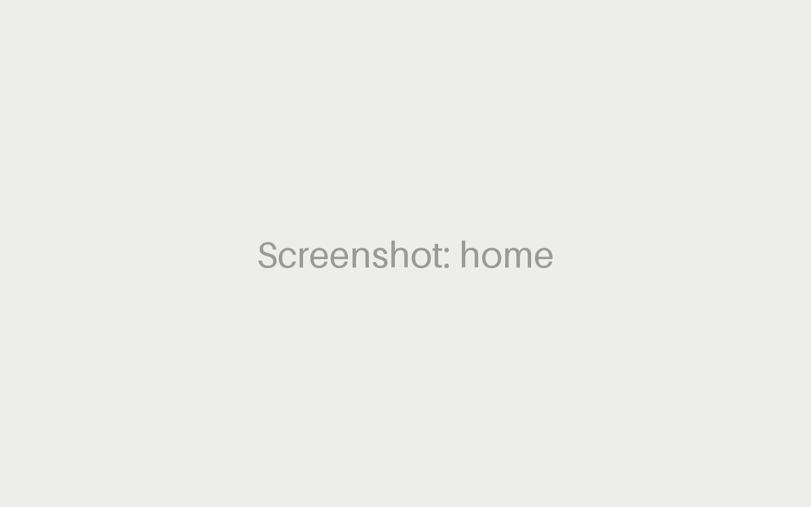
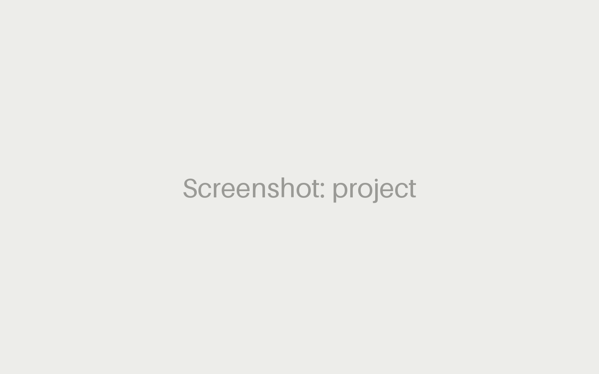
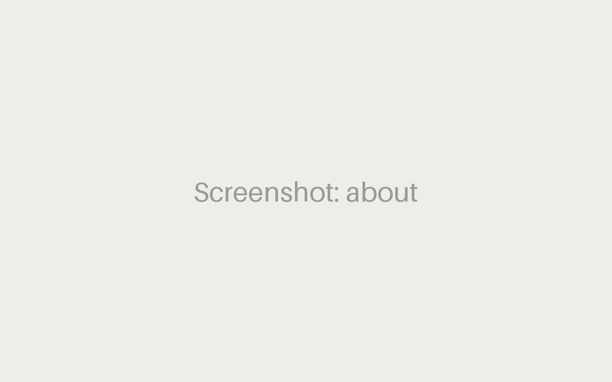
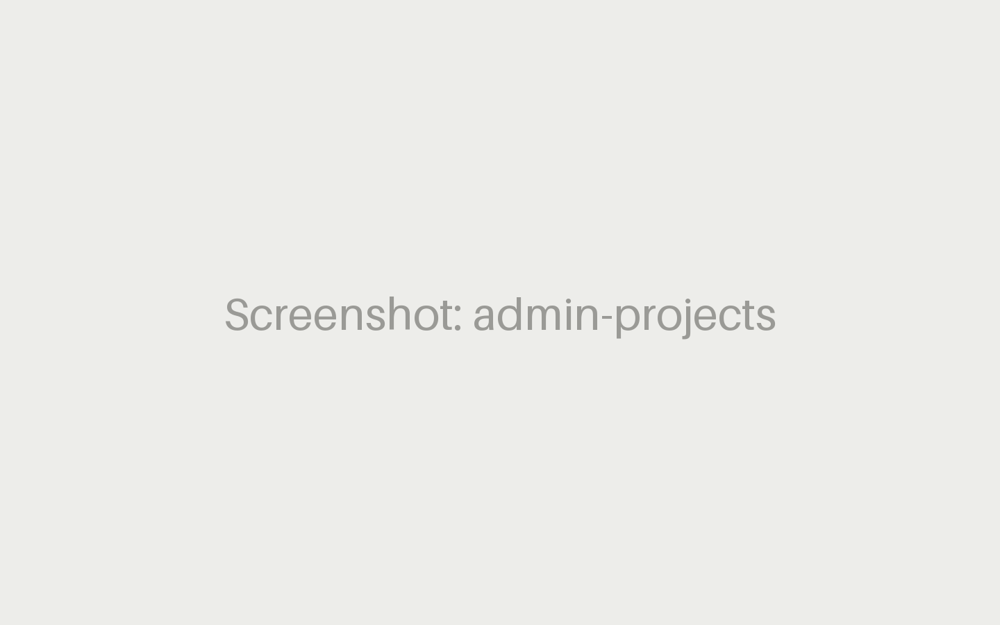
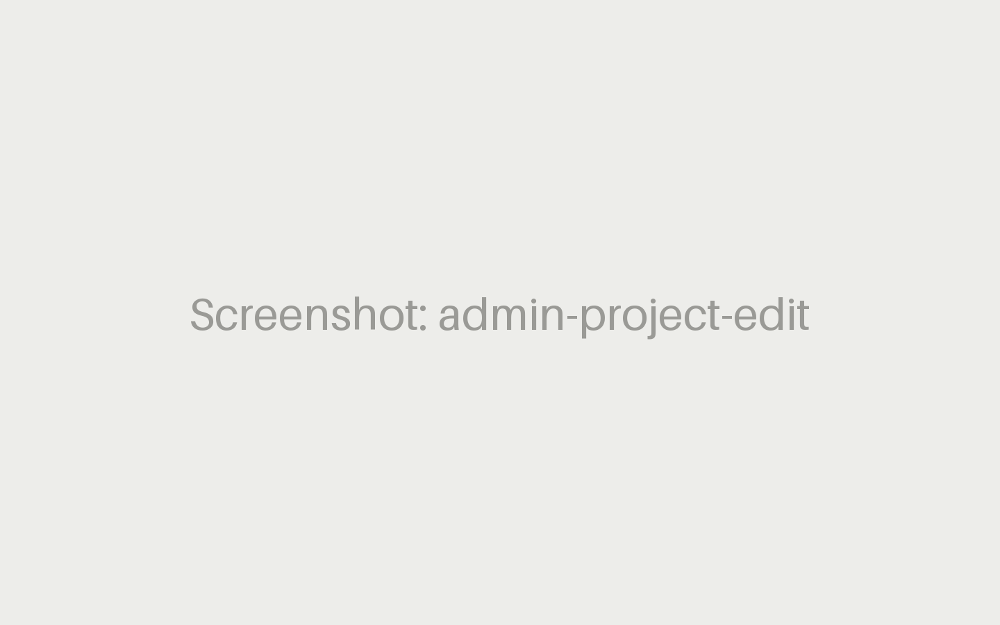
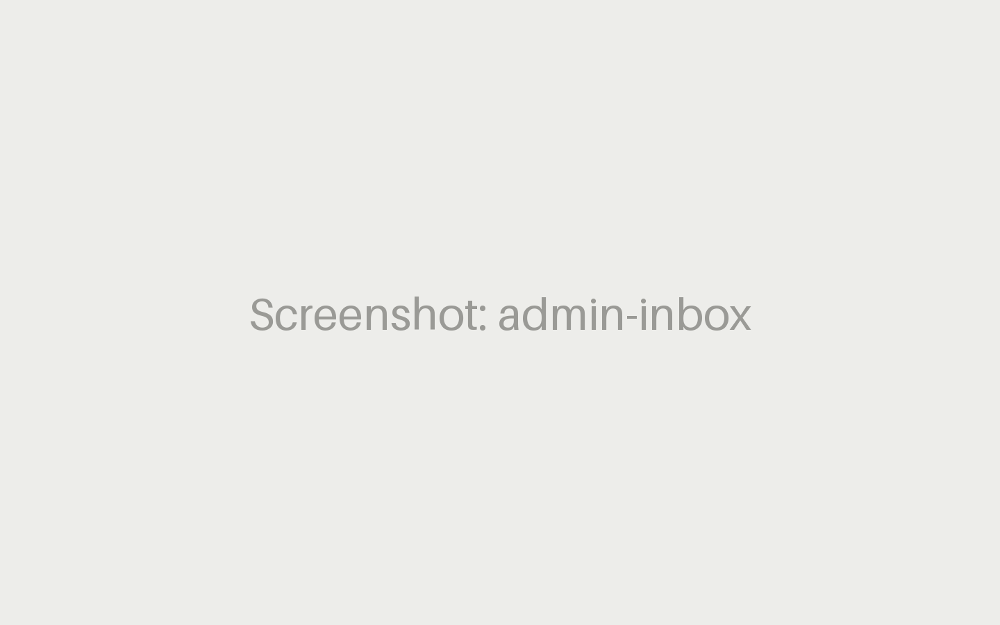

<h1 align="center">icarokucha.com</h1>

<p align="center">
  My personal portfolio, built from scratch with Django.<br>
  Every word, link and project on the site lives in the database and is edited from a custom admin,
  so updating the site never means touching code.
</p>

<p align="center">
  <a href="https://icarokucha.com"><b>Visit the live site</b></a>
</p>

<p align="center">
  
  
  
  
</p>

<p align="center">
  
</p>

---

## How it's structured

The site has three public pages (Home, Project and About) and a private admin that controls all of them. The code is split into two Django apps:

- **`portfolio`**: all the site content (settings, projects, experience, education, skills, services) and the pages that show it.
- **`contact`**: the contact form and the inbox where the messages land.

The pages are plain Django templates styled with Tailwind, built from small reusable components (buttons, chips, cards). Nothing on them is hardcoded: they only handle the layout, and everything they show comes from the database.

## What's on the site

**Home**
- Hero with headline, subheadline and an "Open to work" status badge that I can switch on and off.
- Featured projects as large cards, plus an archive grid below with a filter by project type (it works even with JavaScript turned off).

**Project pages**
- YouTube or Loom video embed, live demo and GitHub buttons (each one only shows up when it exists).
- Numbered key features, stack chips that say what each tool was *for* ("OpenCV: car detection"), an optional architecture image.
- A gallery with a full-screen viewer: arrows, Escape and swipe all work.
- A "Next project" card at the bottom, so visitors keep browsing.



**About**
- Photo, quick facts with icons and a live local clock showing my time zone, languages with levels.
- Experience cards with a work mode badge (On-site, Hybrid, Remote) and expandable details.
- Education, skills, services and a contact form with spam protection.



Every section can be hidden from the admin, and any empty field simply disappears from the page instead of leaving a gap.

**On mobile**

| Home | Project | About |
| --- | --- | --- |
|  |  |  |

## The admin is the real product

The public pages are only half of the project. The other half is the panel I use to run the site, and I wanted it to feel like a proper CMS, not the default Django admin.

- **Modern look** with `django-unfold`: a sidebar grouped by page (Site, Projects, About, Contact) and an unread badge on the inbox.
- **Drag-and-drop ordering** for projects, experience, education, skills, services and languages.
- **One screen per project**: features, stack chips and gallery images are all edited inline, with image previews.
- **Formatting toolbar** (bold, italic, heading, list, link) on every long text, with Ctrl+B and Ctrl+I.
- **Month and year pickers** for dates, because nobody remembers the exact day they started a job.
- **Contact inbox** with read and spam flags, newest first, bulk actions.
- **Safe by default**: the admin lives on a private path (`/admin/` is a 404), and five wrong passwords lock that IP out for an hour.

**Projects list:** drag-and-drop order, featured and published toggles



**Editing a project:** features, stack and gallery on one screen



**Contact inbox**



## Under the hood

| Area | Choice | Why |
| --- | --- | --- |
| Framework | Django 5.2 (LTS), Python 3.12 | The admin comes for free, and learning Django was the point |
| Pages | Server-rendered Django templates | Fast first load and good SEO, no separate frontend to maintain |
| Styling | Tailwind CSS v4, standalone CLI | No Node.js in the project at all |
| JavaScript | A few small vanilla scripts | Only the mobile menu, the gallery viewer and the clock need it |
| Database | SQLite | One editor, low traffic, backups are a single file |
| Images | Pillow, generated WebP thumbnails | Each image is resized once, the first time it is shown |
| Text | Markdown, cleaned with `nh3` | Simple formatting without letting unsafe HTML through |
| Email | Resend through its HTTP API | Notifies me when someone sends a message |

The design was drawn first, as wireframes for desktop and a 390 px phone (they are in [`docs/design/`](docs/design/)), and the site was built to match them.

## Details I cared about

- **Performance**: WebP thumbnails, lazy loading and a small fixed number of queries per page.
- **SEO**: unique titles and descriptions, Open Graph tags, sitemap and robots.txt.
- **Accessibility**: real links and buttons, visible focus, alt text, 44 px touch targets.
- **Security**: honeypot and rate limit on the contact form, upload checks, secrets kept out of the code.
- **Tests**: more than 250, covering models, pages, the admin and the contact form.

## How it was built

I built it in eight sprints, from an empty Django project to the live site, while learning Django along the way. Each sprint ended with something I could open and click to check, before moving on to the next one.

If you are curious about the process:

- [`docs/SPEC.md`](docs/SPEC.md): what the site does, page by page, and the full data model.
- [`docs/ROADMAP.md`](docs/ROADMAP.md): the eight sprints and the changes after launch.
- [`docs/design/`](docs/design/): the wireframes the site was built from.

## Repository map

```
config/       Settings (shared, local, production) and the main URL list
portfolio/    Site content: projects, experience, settings, pages, thumbnails
contact/      Contact form and the admin inbox
templates/    Page layouts and reusable components
static/       Tailwind source, the built CSS and the small JS files
docs/         Spec, roadmap and design wireframes
```

---

<p align="center">
  Designed and built by Icaro Kucha in Curitiba, Brazil.<br>
  The code is open, so feel free to look around.
</p>
